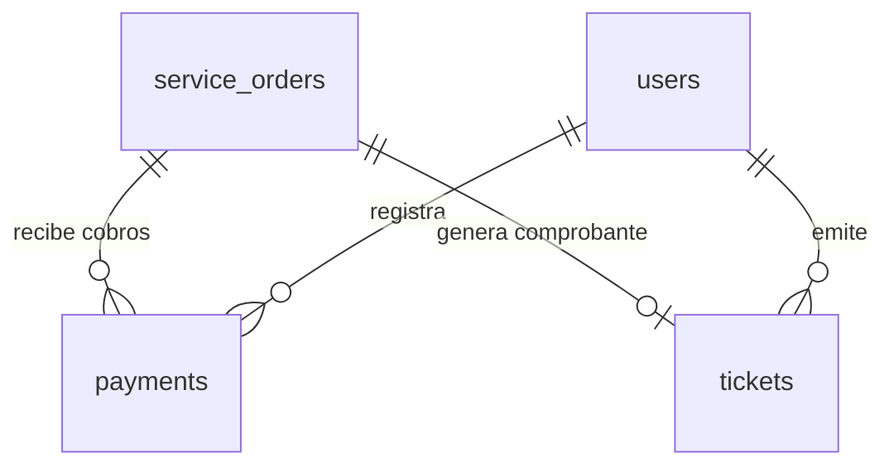

# Modelo de datos — Sprint 4: Pagos, tickets y dashboard

**Fecha**: 2026-10-14
**Rama**: `004-pagos-tickets-dashboard`
**Relacionado**: [plan.md](plan.md), [research.md](research.md),
[spec.md](spec.md)

Este sprint crea **2 tablas nuevas** (`payments`, `tickets`) y **no** añade
columnas a las tablas existentes: el total de la orden, el folio y el contenido
del ticket se calculan en el backend (RN-10). El dashboard no crea tablas: todo
se deriva de los módulos de los Sprints 1–3.

## Entidades nuevas

### `payments` (migración `012_create_payments.sql`)

Historial de intentos de cobro de una orden (RN-13: `order_id` NOT NULL).

| Campo | Tipo | Reglas |
|-------|------|--------|
| `id` | INT UNSIGNED AI | PK |
| `order_id` | INT UNSIGNED NOT NULL | FK → `service_orders.id` (RESTRICT); índice |
| `amount` | DECIMAL(10,2) NOT NULL | `CHECK (amount > 0)`; en la API es cadena `"3150.00"` |
| `method` | ENUM NOT NULL | `'CASH'`, `'CARD'`, `'TRANSFER'`, `'MERCADO_PAGO'` (CA-2) |
| `status` | ENUM NOT NULL | `'PENDING'`, `'PAID'`, `'REJECTED'`, `'CANCELLED'` (FR-003) |
| `external_reference` | VARCHAR(100) NULL | id de la preferencia/pago de Mercado Pago; índice |
| `created_by` | INT UNSIGNED NOT NULL | FK → `users.id` (RESTRICT): quién registró el cobro |
| `created_at` | DATETIME | alta del intento |
| `updated_at` | DATETIME ON UPDATE | última transición de estado |

Sin columnas de tarjeta, tokens ni datos sensibles (RN-14, FR-017). No existe
`DELETE` de pagos: el libro es auditoría.



### `tickets` (migración `013_create_tickets.sql`)

Comprobante mínimo de una orden; el contenido se calcula al servirlo.

| Campo | Tipo | Reglas |
|-------|------|--------|
| `id` | INT UNSIGNED AI | PK; base del folio `TCK-{id:06d}` (R-05) |
| `order_id` | INT UNSIGNED NOT NULL | FK → `service_orders.id` (RESTRICT); **ÚNICO** (un ticket por orden, FR-011) |
| `issued_by` | INT UNSIGNED NOT NULL | FK → `users.id` (RESTRICT) |
| `created_at` | DATETIME | fecha de emisión que muestra el ticket |

Sin desglose almacenado, sin folio propio, sin archivo PDF en disco (supuesto del
spec: vista imprimible; PDF archivado es futuro).

## Estados de pago (máquina de estados, R-02)

Aplicada solo en `payments.service.js`; la API nunca recibe el estado como entrada.

```text
alta con método manual (CASH/CARD/TRANSFER):  ──→ PAID   (terminal)

alta con MERCADO_PAGO:                        ──→ PENDING
    sync (aprobado en el proveedor)     PENDING → PAID    (terminal)
    sync (rechazado en el proveedor)    PENDING → REJECTED (terminal)
    cancel (recepción/administración)   PENDING → CANCELLED (terminal)

PAID | REJECTED | CANCELLED → sin transiciones (sin reembolsos en el MVP)
```

Invariantes (validadas en transacción con bloqueo de fila de la orden):

- **VN-01**: la orden debe existir → 404 `SERVICE_ORDER_NOT_FOUND` (RN-13).
- **VN-02**: la orden debe estar `FINISHED` o `DELIVERED` → 400
  `ORDER_NOT_PAYABLE` (los estados `RECEIVED/DIAGNOSIS/IN_REPAIR/WAITING_PART`
  no son cobrables).
- **VN-03**: `amount` (si viene) debe ser exactamente el total calculado de la
  orden → 400 `PAYMENT_AMOUNT_MISMATCH` (Q1: sin pagos parciales).
- **VN-04**: máximo un pago `PAID` por orden → 400 `ORDER_ALREADY_PAID`.
- **VN-05**: máximo un pago `PENDING` activo por orden → 409
  `PENDING_PAYMENT_EXISTS` (los estados terminales no bloquean un reintento).
- **VN-06**: `sync` y `cancel` exigen un pago propio `MERCADO_PAGO` en `PENDING`
  → 409 `INVALID_PAYMENT_TRANSITION` en otro caso; `sync` sin credenciales → 409
  `MERCADO_PAGO_NOT_CONFIGURED`; error del proveedor → 502
  `MERCADO_PAGO_ERROR` (R-04).
- **VN-07**: el método debe ser uno de los 4 → 400 `VALIDATION_ERROR`.

## Total de la orden (calculado, R-03)

Sin columna almacenada. Fórmula única, reutilizada por el endpoint de total, la
validación de pago (VN-03) y el ticket:

```text
servicesSubtotal = Σ order_services.unit_price
laborSubtotal    = Σ (order_labor.hours × order_labor.hourly_rate)
partsSubtotal    = Σ (order_parts.quantity × parts.sale_price)   -- precio vigente
total            = servicesSubtotal + laborSubtotal + partsSubtotal
```

`order_id` sin filas en las tres tablas → total `"0.00"` (una orden sin trabajo
registrado no puede pagarse porque VN-03 exige `amount > 0` vía el `CHECK`).

## Ticket (calculado, R-05)

- **Folio**: `TCK-` + id con 6 dígitos (`TCK-000001`); derivado, sin contador.
- **Emisión**: solo órdenes `FINISHED`/`DELIVERED` → 400 `ORDER_NOT_FINISHED`.
- **Idempotencia**: `order_id` ÚNICO; `POST` crea (201) o devuelve el existente
  (200).
- **Contenido servido** (CA-4): folio, datos del taller (constant en
  `server/config/taller.js`), cliente, vehículo, placas, kilometraje de entrada,
  servicios, refacciones (con cantidad y precio vigente), mano de obra (horas ×
  tarifa), subtotales, total, método y estado del pago (si existe) y fecha de
  emisión. Sin pago registrado → `payment: null` y la interfaz muestra «Sin pago»
  (US3 escenario 4).

## Dashboard (derivado, sin tablas, R-08)

`GET /api/dashboard` (solo ADMIN) compone en una consulta única:

| Indicador | Fuente | Regla |
|-----------|--------|-------|
| `vehiclesAttended` | `service_orders` | `COUNT(DISTINCT vehicle_id)` con `status IN ('FINISHED','DELIVERED')` |
| `vehiclesInRepair` | `service_orders` | `COUNT(DISTINCT vehicle_id)` con `status IN ('RECEIVED','DIAGNOSIS','IN_REPAIR','WAITING_PART')` |
| `ordersPending` | `service_orders` | `COUNT(*)` con los 4 estados activos |
| `ordersFinished` | `service_orders` | `COUNT(*)` con `FINISHED`/`DELIVERED` |
| `nextAppointments` | `appointments` | `COUNT(*)` con `appointment_date >= hoy` y `status IN ('PENDING','CONFIRMED')` |
| `upcomingMaintenances` | `maintenance` | estado calculado `UPCOMING` (misma regla que la lista, `utils/maintenance-state.js`) |
| `overdueMaintenances` | `maintenance` | estado calculado `OVERDUE` |
| `lowStockCount` | `parts` | `stock_current <= stock_min` (mismo filtro del inventario) |

Detalle devuelto junto al resumen: últimas 5 órdenes, próximas 5 citas,
mantenimientos próximos (5) y vencidos (todos), refacciones en stock bajo
(todas). Contador y detalle se calculan en la misma ejecución (SC-007).

## Tablas existentes consultadas (sin cambios)

`service_orders`, `order_services`, `order_labor`, `order_parts`, `parts`,
`appointments`, `maintenance`, `vehicles`, `clients`, `users`. Ninguna recibe
columnas nuevas en este sprint.

## Migraciones nuevas

| Script | Contenido |
|--------|-----------|
| `012_create_payments.sql` | tabla `payments` con FKs, índices (`order_id`, `status`, `external_reference`) y `CHECK (amount > 0)` |
| `013_create_tickets.sql` | tabla `tickets` con FKs, índice único en `order_id` |

Ambas con `ENGINE=InnoDB DEFAULT CHARSET=utf8mb4 COLLATE=utf8mb4_unicode_ci`,
`ON DELETE RESTRICT ON UPDATE CASCADE` y registro en `schema_migrations`, al
igual que las 001–011. Las seeds del sprint (R-11) añaden un pago `PAID` y su
ticket sobre la orden terminada existente, idempotentes por orden.
